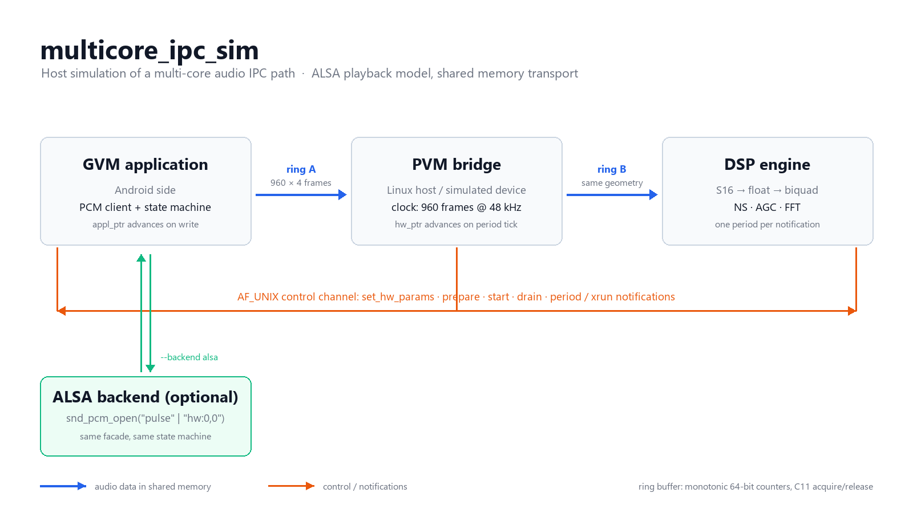

# multicore_ipc_sim

主机仿真的**多核 IPC 音频通路**：三个进程复现「Android(GVM) → Linux(PVM) → DSP」
的共享内存音频传输，核心是 **ALSA playback 的 `appl_ptr` / `hw_ptr` 闭环**。

> 现状：**M1–M6 完成**。三进程端到端跑通，DSP 接入 `mini_dsp` 算法库，
> 具备统计面板、故障注入，以及可切换的仿真 / 真 ALSA 双后端。



一句话概括：应用把 S16_LE 交错样本写进共享内存 ring A，宿主进程按 20 ms 的
period 把它转进 ring B，DSP 按通知消费并跑算法；控制与通知走独立的 AF_UNIX 通道，
`hw_ptr` 只由设备侧的 period tick 推进。

## 已实现

| 里程碑 | 内容 |
|---|---|
| M1 | `mcshm_ring`：POSIX shm + 单调计数器 + C11 原子 + 陈旧段回收 |
| M2 | `mccmd`：AF_UNIX 控制通道、帧协议；GVM/PVM 两进程单跳 |
| M3 | `mcpcm`：ALSA 式状态机、`hw_ptr` 由设备推进、period 通知唤醒 poll、xrun 上报 |
| M4 | PVM 双端桥接（A→B 转发）、`dsp_engine` 接入 `mini_dsp` pipeline、`mcs16` 格式边界 |

### M4 细节

- **双端桥接**：PVM 监听两个 socket（应用端 `/tmp/x.sock`、DSP 端 `/tmp/x.sock.dsp`），
  各自建一条 ring；按 period 从 A 读、写入 B，写不下就计 drop，绝不阻塞设备时钟
- **第二跳同样有通知**：每转发一个 period，向 DSP 发一条 `PERIOD`，
  DSP 因此是被"中断"驱动，而不是自己轮询
- **格式边界只有一处**：`mcs16_to_float` / `mcs16_from_float` 在 DSP 入口，
  shm 里始终是 S16_LE 交错数据
- **声道拆分**：`mini_dsp` 的 biquad 每模块只有一组历史状态，所以按声道解交织、
  每声道跑一条 mono pipeline、再交织回去——而不是假装模块支持多声道

## 构建与测试

```bash
cmake -S . -B build -DCMAKE_BUILD_TYPE=Debug -DSIM_WERROR=ON -DSIM_SANITIZE=ON
cmake --build build
ctest --test-dir build --output-on-failure
```

`mini_dsp` 默认从 `../mini_dsp` 取算法源码，可用 `-DMINI_DSP_DIR=...` 指定；
找不到时 DSP 端不构建，其余测试照常。

单独演示：

```bash
./build/pvm_router /tmp/mc.sock &
./build/dsp_engine /tmp/mc.sock &
./build/gvm_app /tmp/mc.sock 100
```

## 一键演示

```bash
./scripts/demo.sh          # 三个场景全跑
./scripts/demo.sh sim      # 三进程干净播放（2 s 音频）
./scripts/demo.sh fault    # 时钟抖动 + 丢帧 + 应用停播注入
./scripts/demo.sh alsa     # 真 ALSA 输出（默认 pulse，可用 ALSA_DEVICE 覆盖）
```

脚本会自动构建，每个场景打印关键计数（三端帧数、丢帧、underrun、墙钟），
并在结尾给出判定。三个场景都应该以 `demo: ok` 结束。

## 实测结果

Ubuntu 22.04 / gcc 11.4，`-Werror` + ASan/UBSan，**ctest 7/7 通过**：

| 测试 | 内容 | 耗时 |
|---|---|---|
| `ring_selftest` | 47 项，含双进程 fork | 0.03 s |
| `ipc_single_hop` | 两进程、背压、资源回收 | 1.99 s |
| `pcm_state_machine` | 状态机 + 正常播放 + 停播 xrun | 4.14 s |
| `multichannel_32` | 32 声道、每声道独立状态、33 声道拒绝 | 0.02 s |
| `three_process_pipeline` | 三进程、两跳、算法链路 + FFT | 2.22 s |
| `fault_injection` | 统计面板 + 抖动 + 丢帧 + 停播注入 | 1.56 s |
| `alsa_backend` | **真 libasound 播放，实时性校验** | 1.05 s |

三进程实测（2.000 s 音频 / 1.920 s 墙钟）：

```
GVM_STATS  frames=96000 periods=100 full_events=96 xruns=0
PVM_gvm_STATS frames=96000 periods=100 empty=0 underruns=0 drops=0
PVM_dsp_STATS frames=96000 periods=100 empty=0 underruns=0 drops=0
DSP_STATS  frames=96000 periods=100 empty=0 channels=2
DSP: rms in 0.139738 out 0.139541
  ratio out/in = 0.9986   ← 440 Hz 通过 100 Hz 高通的增益
```

三端帧数完全一致（96000），桥接零丢帧，增益 0.9986 与高通在 440 Hz 处 |H|≈1 吻合。

## 观测与故障注入（模拟设备侧）

PVM 就是"硬件"，所以观察点和注入点都放在这里：

```bash
./build/pvm_router /tmp/mc.sock --stats --stats-every 10 \
                                --jitter-us 600 --drop-pct 15 --stall-at 40 120
```

| 开关 | 作用 |
|---|---|
| `--stats` / `--stats-every N` | 每 N 个 period 打一行 CSV 到 stdout |
| `--jitter-us N` | 每个 period 在标称时间点上叠加 ±N µs 抖动 |
| `--drop-pct P` | 第二跳按 P% 概率丢帧 |
| `--stall-at K MS` | 第 K 个 period 冻结设备 MS 毫秒 |

实测输出（应用在 25 号 period 停播 250 ms）：

```
PVM_STAT t_ms=399 appl=22080 hw=19200 fill=2880 xruns=0 drops=960  lat_ms=60.0 jitter_us=-380
PVM_STAT t_ms=600 appl=24000 hw=24000 fill=0    xruns=5 drops=1920 lat_ms=0.0  jitter_us=243
PVM_STAT t_ms=799 appl=33600 hw=30720 fill=2880 xruns=8 drops=1920 lat_ms=60.0 jitter_us=-204
```

`fill=0 / lat_ms=0.0 / xruns` 从 0 跳到 5 —— 这就是 underrun 的现场；
`drops` 按 15% 概率累积，最终 DSP 收到 52800 帧而应用写了 57600 帧，差额与丢帧注入吻合。

## 目录

```
multicore_ipc_sim/
├── include/  mcshm_ring.h  mccmd.h  mcpcm.h  mcpcm_ops.h  mcs16.h
├── src/      mcshm_ring.c  mccmd.c  mcpcm.c  mcpcm_ops.c  mcpcm_alsa.c  mcs16.c
├── apps/     pvm_router.c  gvm_app.c  dsp_engine.c
├── tests/    ring_selftest.c  multichannel_selftest.c
│             run_m2.sh  run_m3.sh  run_m4.sh  run_m5.sh  run_m6.sh
├── scripts/  demo.sh
└── docs/     architecture.md
```

## 路线图

| 里程碑 | 内容 | 状态 |
|---|---|---|
| M1 | 共享内存环形缓冲 | ✅ |
| M2 | 控制通道 + 两进程单跳 | ✅ |
| M3 | 状态机、`hw_ptr`、poll、xrun | ✅ |
| M4 | 第二跳 + DSP 算法接入 | ✅ |
| M5a | 32 声道：biquad 每声道状态、NS 32 路、运行时 FFT | ✅ |
| M5b | 统计面板 + 故障注入（模拟设备侧） | ✅ |
| M5c | **后端抽象 `mcpcm_ops` + 真 ALSA 实现** | ✅ |

> 剩余：应用侧声道数参数化（当前固定 2 声道），真硬件 `hw:0,0` 验证。

## 双后端（M6）

同一份应用代码可以跑在两种设备后端上，切换只改命令行：

```bash
./build/gvm_app /tmp/mc.sock 100                    # 仿真：shm + 控制通道
./build/gvm_app --backend alsa --device pulse 50    # 真实 ALSA：WSLg → Windows 音频
./build/gvm_app --backend alsa --device hw:0,0 50   # 真实声卡（有 /dev/snd 的机器）
```

实测（`--device pulse`，1.000 s 音频）：

```
GVM: backend=alsa device=pulse state=setup
  [ok]   write in setup refused
  [ok]   prepare while running refused
GVM_STATS frames=48000 periods=50 full_events=0 xruns=0 elapsed_ms=928.4
  [ok]   device paced the writer in real time
```

928 ms 墙钟对应 1.000 s 音频（差值是 drain 把尾部留在设备缓冲里），
证明 ALSA 设备真的在反向限速，而不是像 `null` 插件那样 3 ms 吞完。

## 已知限制（下一步要解决）

- **32 声道已打通**：`mini_dsp` 的 biquad 现在每声道独立历史、`ns` 上限提到 32、
  `fft_plan` 支持任意 2 的幂（960 帧 period 用 1024 点补零分析，分辨率 46.875 Hz）；
  33 声道会被模块明确拒绝。应用侧目前仍固定用 2 声道，需要时可参数化。
- **DSP 时钟**：目前由 PVM 的 period 通知驱动，尚未实现 DSP 侧独立时钟与漂移补偿
- 桥接在 B 满时丢帧（计数），没有做反压到 A

## 实现中真实踩到的坑

| 现象 | 根因 | 修法 |
|---|---|---|
| `ftruncate`/`usleep` 未声明 | `-std=c11` 隐藏 POSIX 符号 | `_POSIX_C_SOURCE` + `nanosleep` |
| PVM 退出码 141 | 对端关闭后写 socket → SIGPIPE | `send(..., MSG_NOSIGNAL)` |
| `/dev/shm` 残留 | 段名含 pid，崩溃后无法回收 | 稳定段名 + create 时回收 |
| 参数解析比指针 | `p == "literal"` | 显式标志位 |
| 桥的 DSP 端统计少 2880 帧 | DRAIN 路径转发未计入统计 | 两处都计数 |
